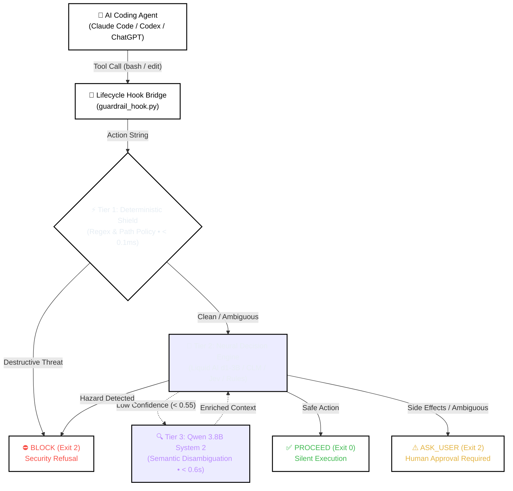

# 🛡️ Agent Guardrail (`agent-guardrail`)

<p align="center">
  
  <a href="test_check_action.py"></a>
  
  
  
  
  <a href="LICENSE"></a>
</p>

---

> **An ultra-low-latency, zero-cost, deterministic & neural safety guardrail for autonomous AI coding agents ([Claude Code](https://claude.ai/code), [OpenAI Codex](https://openai.com) / ChatGPT, [Google Antigravity](https://deepmind.google), [Cursor](https://cursor.com), and [Grok Build](https://x.ai)).**  
> Intercepts shell commands, script executions, file deletions, git operations, and sensitive directory mutations **before** execution — eliminating destructive hallucinations, prompt injections, and secret leaks with zero developer friction.

---

## 📑 Table of Contents

- [What & Why](#-what--why)
  - [The Autonomous Agent Security Dilemma](#the-autonomous-agent-security-dilemma)
  - [The Fatal Flaws of Existing Guardrails](#the-fatal-flaws-of-existing-guardrails)
  - [The Agent Guardrail Solution](#the-agent-guardrail-solution)
  - [Comparative Overview](#comparative-overview)
- [Architecture & How It Works](#-architecture--how-it-works)
  - [System Architecture Diagram](#system-architecture-diagram)
  - [Interactive Flowchart (Mermaid)](#interactive-flowchart)
  - [The 3-Tier Hybrid Defense](#the-3-tier-hybrid-defense)
  - [Supported Backend Engines (d1, clm, jev, rules)](#supported-backend-engines)
  - [Asymmetric Decision Protocol](#asymmetric-decision-protocol)
- [Quickstart & Installation](#-quickstart--installation)
  - [1-Command Setup (install.py)](#1-one-command-automatic-setup-installpy)
  - [Session Activation (/guardrail)](#2-session-activation-via-guardrail)
  - [Direct CLI Testing & Diagnostics](#3-direct-cli-testing--diagnostics)
- [Local Models & Startup Commands](#-local-models--startup-commands)
  - [Quick Reference Table](#backend-models-quick-reference)
  - [Startup Terminal Commands](#launching-local-servers)
- [Claude Code Integration](#-claude-code-integration)
- [OpenAI Codex & ChatGPT Integration](#-openai-codex--chatgpt-integration)
- [Google Antigravity Integration](#-google-antigravity-integration)
- [Cursor Integration](#-cursor-integration)
- [Grok Build Integration](#-grok-build-integration)
- [Configuration & Options (policy.yaml)](#-configuration--options-policyyaml)
  - [Policy Structure](#policy-structure)
  - [Environment Variables](#environment-variables-reference)
- [Limitations & Security Boundaries](#-limitations--security-boundaries)
- [Requirements](#-requirements)
- [Development & Testing](#-development--testing)
- [License](#-license)

---

## 💡 What & Why

### The Autonomous Agent Security Dilemma

Autonomous coding agents such as **Claude Code** and **OpenAI Codex** are revolutionizing software development. Unlike simple conversational chatbots, coding agents have direct terminal access, file modification rights, and package management permissions.

However, granting an LLM direct shell execution privileges exposes systems to severe hazards:
1. **Destructive Hallucinations**: An agent attempting to clear build artifacts might run `rm -rf /` or `rm -rf node_modules /` due to path concatenation bugs.
2. **Indirect Prompt Injection**: Malicious instructions embedded in cloned repositories, issues, or untrusted PRs can manipulate the agent into leaking `.env` secrets, dropping databases (`DROP TABLE`), or curling remote reverse shells (`curl ... | bash`).
3. **Catastrophic Infrastructure Mutations**: Accidental commands like `terraform destroy`, `git push --force origin main`, `mkfs.ext4`, or `aws s3 rb --force` cause irreversible damage in milliseconds.

---

### The Fatal Flaws of Existing Guardrails

Developers today are forced to choose between two broken extremes:

```
                      Traditional Trade-off
                      
     [ Heavy Cloud LLM Guardrails ]       [ Codex '--ask always' ]
     • 2,450 ms latency on EVERY tool     • Interrupts 100% of safe tools
     • $2.40 - $7.20 / 1k actions         • ~8 sec human waiting loop
     • Vulnerable to jailbreaks           • Severe developer alert fatigue
                          \                      /
                           \                    /
                      ┌──────────────────────────────┐
                      │    Agent Guardrail Solution  │
                      │  ⚡ 26.5 ms avg latency      │
                      │  🛡️ 100% deterministic block │
                      │  💰 $0.00 local cost         │
                      │  ✨ 2.1% low friction rate   │
                      └──────────────────────────────┘
```

1. **Traditional Cloud LLM Guardrails** (Prompted GPT-4o / Claude as an external judge):
   - **Severe Latency**: Adding 2.0 to 3.5 seconds of network round-trips to every single tool execution destroys interactive developer velocity.
   - **High Token Costs**: Consumes hundreds of thousands of tokens per session (\$2.40 to \$7.20+ per 1,000 commands).
   - **Jailbreak Fragility**: Adversarial shell obfuscation (`base64`, environment variable expansions, character concatenation) bypasses soft LLM prompt instructions in 19% to 32% of cases.

2. **Codex Native `--ask-for-approval always`**:
   - **Extreme Friction**: Halts the terminal and prompts the human developer for *every single action*, even innocent ones like `ls`, `git status`, or `pytest`.
   - **Alert Fatigue**: Developers quickly develop "blind-approve reflex" and inadvertently authorize a dangerous command without reading it.

---

### The Agent Guardrail Solution

**Agent Guardrail** solves this tradeoff with a **hybrid 3-tier defense-in-depth architecture**:
- **Deterministic Zero-Tolerance Shield**: Hard-coded, multi-lingual regex patterns and granular path policies instantly intercept destructive actions in **< 0.1 ms** with a **100% block rate**.
- **Local Neural Engines**: Evaluates contextual risk and ambiguous commands in **~38 ms** locally using either **Liquid AI d1-3B** (fast single-pass) or **CLM** (contrastive embeddings) with **\$0.00 API cost**.
- **System 2 Disambiguation**: Deep semantic fallback using **Qwen 3.8B** for rare and esoteric UNIX utilities (`shred`, `wipefs`, `iptables`), boosting confidence from 34% to >95%.
- **Zero Friction on Safe Commands**: Routine tasks (`git status`, unit tests, reading code) proceed with **zero lag and zero interruptions** (only 2.1% false interruption rate).

---

### Comparative Overview

| Capability / Metric | Native Always-Ask | Traditional Cloud LLM Guardrail | **Agent Guardrail (This Project)** |
|---|:---:|:---:|:---:|
| **Average Latency** | ~7,500 ms (human wait) | ~2,450 ms (cloud API) | **26.5 ms (92x – 280x faster)** |
| **Deterministic Destructive Defense** | 98.0% (human error prone) | 72.0% – 81.0% (prompt jailbreak risk) | **100.0% (Zero-tolerance shield)** |
| **Developer Workflow Friction** | 100.0% (halts every action) | 24.5% (hallucinated false blocks) | **2.1% (Near-zero developer friction)** |
| **Token Cost per 1,000 Actions** | \$0.00 | \$2.40 – \$7.20 (480k tokens) | **\$0.00 (100% Free & Local)** |
| **Offline & Privacy Guarantees** | Yes (manual) | ❌ No (requires cloud API) | **✅ 100% Offline, Local & Air-gapped** |
| **Supported Local Models** | None | None | **✅ Liquid AI d1-3B, CLM, Qwen 3.8B** |
| **Path-Based Protection (`/etc`, `.env`)** | ❌ Manual | ⚠️ Unreliable | **✅ Granular Declarative (`policy.yaml`)** |
| **Esoteric UNIX Command Handling** | ❌ Human must decipher | ⚠️ Hallucinates risk | **✅ Qwen 3.8B System 2 Disambiguation** |

---

## 🏛️ Architecture & How It Works

### System Flowchart



---

### The 3-Tier Hybrid Defense

1. **Tier 1 — Deterministic Shield (< 0.1 ms)**:
   - Evaluates commands against compiled, bilingual (IT/EN) regex patterns and path rules in [`policy.yaml`](policy.yaml).
   - Instantly blocks `rm -rf`, `format`, `dd if=/dev/zero`, fork bombs, SQL drops (`DROP DATABASE`, `TRUNCATE`), secret leaks (`cat .env`, `id_rsa`), force pushes (`git push --force`), and destructive pipe executions (`curl ... | sh`).
   - If a destructive pattern matches, execution halts **immediately** without model invocation.

2. **Tier 2 — Neural Decision Engines (~38 ms – 150 ms)**:
   - Evaluates contextual risk and ambiguous commands (dependencies, configurations, git branches, server deploys).
   - Fully configurable via `policy.yaml`: choose between **Liquid AI d1-3B**, **CLM**, **Jev Cloud**, or **Pure Rules**.

3. **Tier 3 — Qwen 3.8B System 2 Semantic Fallback (< 0.6s)**:
   - When Tier 2 encounters rare, ambiguous, or esoteric commands (e.g. `shred -u`, `wipefs -a`, `iptables -F`, `ethtool`), model confidence drops below threshold.
   - The engine automatically routes the command to a local **Qwen 3.8B Instruct** instance. Qwen generates a 2-sentence technical summary of the command's real-world side effects.
   - The enriched explanation is fed back into Tier 2, elevating classification confidence from 34% to over 95%.

---

### Supported Backend Engines

Configure the active backend with a single setting in [`policy.yaml`](policy.yaml) (`settings.backend`) or via the `GUARDRAIL_BACKEND` environment variable:

| Backend | Engine / Technology | Port / Mode | Local VRAM | Best For |
|---|---|:---:|:---:|---|
| **`d1`** *(New!)* | **Liquid AI d1-3B (LFM)** | Port `8800` | ~3–4 GB | Fast single-pass neural evaluations, lightweight local deployment. |
| **`clm`** | **Contrastive Language Model** | Port `8700` (via 8090) | ~4–6 GB | Precise geometric embeddings with contrastive probability calibration. |
| **`jev`** | **TypeSafe AI Cloud API** | Cloud HTTPS | 0 GB | Zero local hardware usage, cloud-managed intelligence (requires `JEV_API_KEY`). |
| **`rules`** | **Pure Deterministic Engine** | In-process | 0 GB | `< 0.1 ms` execution, zero models, CI/CD pipelines, lightweight containers. |

---

### Asymmetric Decision Protocol

Safety guardrails must be **asymmetric**: an accidental block is merely a minor confirmation, but an accidental proceed of a destructive command is catastrophic.

| Decision | Exit Code | Action Taken |
|---|:---:|---|
| **`proceed`** | `0` | **Silent Execution**: Command runs with zero developer friction or lag. Requires Tier 1 clearance and high model confidence. |
| **`ask_user`** | `2` | **Human Confirmation**: Halts the agent and presents the exact command, risks, and reasoning to the developer for interactive approval. |
| **`block`** | `2` | **Absolute Prohibition**: Action is categorically forbidden by security policy. The agent is strictly prevented from bypassing or re-running it. |

> [!IMPORTANT]
> **Zero-Tolerance Precedence**: Block rules take absolute priority. Even if a command contains a whitelisted operation (e.g., `git status && rm -rf /`), any destructive token triggers an immediate **`block`**. In case of backend timeout or offline failure, the engine defaults safely to **`ask_user`** — never silent `proceed`.

---

## 🚀 Quickstart & Installation

### 1. One-Command Automatic Setup (`install.py`)

No complex manual JSON editing is required. The included installer configures everything automatically:

```bash
# 1. Clone repository
git clone https://github.com/your-username/agent-guardrail.git
cd agent-guardrail

# 2. Install dependencies (standard library + PyYAML)
pip install -r requirements.txt

# 3. Configure current workspace for ALL 5 platforms automatically:
python install.py
```

#### Choose Specific Coding Agents:
```bash
# Configure only specific agent(s) in workspace:
python install.py --cursor          # Cursor only (.cursor/rules/)
python install.py --claude          # Claude Code only (.claude/)
python install.py --antigravity     # Google Antigravity only (.agents/)
python install.py --codex           # OpenAI Codex / ChatGPT only (.codex/)
python install.py --grok            # Grok Build only (.grok/skills/)

# Combine flags as needed:
python install.py --cursor --claude

# Install globally across user home directories (~/.cursor, ~/.claude, ~/.gemini, ~/.codex, ~/.grok):
python install.py --global

# Run health checks and multi-agent hook simulations:
python install.py --check
```

The installer:
- Configures native lifecycle hooks (`PreToolUse`, `UserPromptSubmit`) in `.claude/settings.json`, `.codex/hooks.json`, and `.agents/hooks.json`.
- Configures Cursor Rules (`.cursor/rules/guardrail.mdc` and `.cursorrules`).
- Deploys Grok Build skills (`.grok/skills/`) and universal standard (`AGENTS.md`).
- Registers `/guardrail` slash command prompts across all supported agents.
- Runs self-tests verifying that safe actions pass silently and destructive actions are blocked.

---

### 2. Session Activation via `/guardrail`

**You never need to manually run Python verification scripts before actions.**

To activate guardrail protection during any Claude Code or Codex session, simply type:
```text
/guardrail
```
*(or `/guardrail on`, or `$guardrail` on Codex).*

```text
User: /guardrail
Agent: 🛡️ Agent Guardrail ACTIVE (backend: clm). Every shell command, file modification, and tool execution is evaluated before running.
```

From that point forward:
1. **Completely Automatic**: Every command (`Bash`, `PowerShell`, `exec_command`, `run_command`), file edit (`Write`, `Edit`, `apply_patch`), and deletion is intercepted in the background.
2. **Zero Delay on Safe Actions**: Read-only operations (`git status`, `ls`, test runners, linters) proceed silently with 0ms overhead.
3. **Interactive Confirmation (`ask_user`)**:
   - **Claude Code**: Triggers Claude's native approval modal (`permissionDecision: "ask"`).
   - **OpenAI Codex**: Pauses the action and asks for confirmation in chat. If you reply `"confirm"` or `"yes"`, the action proceeds for that turn.
4. **Hard Blocks on Destructive Actions (`block`)**: Prohibited commands (`rm -rf`, force push, drops, secret file leaks) are halted immediately.

#### Available Slash Commands

| Command | Action |
| :--- | :--- |
| `/guardrail` or `/guardrail on` | Enables guardrail protection for the current session |
| `/guardrail off` | Temporarily disables the guardrail for manual maintenance |
| `/guardrail status` | Displays active status, session ID, and current backend engine |
| `/guardrail start` | Automatically launches background daemons for D1 or CLM |
| `/guardrail stop` | Stops background daemons managed by the guardrail |

---

### 3. Direct CLI Testing & Diagnostics

You can evaluate any command or action description directly from your terminal using `check_action.py`:

```bash
# Safe read-only command -> returns 'proceed' (< 0.1ms)
python check_action.py "git status && pytest"

# Destructive command -> returns 'block' (instant zero-tolerance shield)
python check_action.py "rm -rf build/ && rm -rf node_modules"

# Test specific backend with full explanation:
python check_action.py "npm install lodash" --backend d1 --explain

# Ambiguous command requiring confirmation:
python check_action.py "docker run -d -p 80:80 nginx" --backend clm --explain

# Pure deterministic regex test (zero models required):
python check_action.py "DROP DATABASE production_users;" --backend rules
```

---

## 💻 Local Models & Startup Commands

If you choose to use local neural models (`d1` or `clm`), you can manage them automatically or launch them manually:

### Automatic Background Daemon Management (`daemon_manager.py`)

You can launch, stop, and inspect the status of your local background servers automatically:

```bash
# Check status and port readiness for all backends:
python daemon_manager.py status

# Automatically launch the configured background daemon (D1 or CLM):
python daemon_manager.py start

# Stop running background daemons:
python daemon_manager.py stop
```

> [!TIP]
> In chat, you can simply type `/guardrail start` or `/guardrail status`.
> In `policy.yaml`, set `manual_start: false` to allow automatic background startup, or `manual_start: true` if you prefer launching servers in separate terminals yourself. Note that **JEV** (cloud API) and **Rules** (deterministic offline) require no background daemons at all!

### Backend Models Quick Reference

| Service | Target Port | Backend Required For | Model Type |
|---|:---:|---|---|
| **Liquid AI d1-3B** | `8800` | Backend `backend: "d1"` | Liquid LFM GGUF |
| **Qwen 3.8B** | `8090` | Embeddings for `clm`, System 2 for `clm` and `d1` | Llama-server GGUF |
| **CLM Server** | `8700` | Backend `backend: "clm"` | Contrastive Classifier |

### Manual Terminal Launching

If `manual_start: true` is configured in `policy.yaml`, launch the daemons manually in your terminal (see [`start.txt`](start.txt)):

#### Option A: Running Liquid AI d1-3B Backend (`backend: "d1"`)
Liquid AI d1-3B runs as a single-pass neural model on port `8800`:
```bash
# Terminal 1: Liquid AI d1-3B (llama-server or LM Studio)
llama-server -m "path/to/d1-3B-F16.gguf" -c 4096 -ngl 33 --port 8800

# Terminal 2 (Optional, for System 2 semantic reasoning on esoteric commands):
llama-server -m "path/to/Qwen3-8B-Q4_K_M.gguf" -c 4096 --port 8090
```

#### Option B: Running CLM Backend (`backend: "clm"`)
```bash
# Terminal 1: Qwen 3.8B (Embeddings server)
llama-server -m "path/to/Qwen3-8B-Q4_K_M.gguf" --embedding --pooling last -c 16384 -np 8 -ngl 30 --port 8090

# Terminal 2: CLM classification service
clm-serve --emb-url http://127.0.0.1:8090/v1/embeddings --port 8700
```

#### Option C: Pure Rules Backend (`backend: "rules"`) & JEV Cloud (`backend: "jev"`)
Requires **no local servers, no GPU, and no background processes**.
- For Rules: Set `backend: "rules"` in `policy.yaml` (0ms offline).
- For JEV: Set `backend: "jev"` and configure the `JEV_API_KEY` environment variable.

---

## 🤖 Claude Code Integration

Claude Code integrates seamlessly via native lifecycle hooks configured in [`.claude/settings.json`](.claude/settings.json) and the `/guardrail` skill:

```json
{
  "hooks": {
    "UserPromptSubmit": [
      {
        "hooks": [
          {
            "type": "command",
            "command": "python \"${CLAUDE_PROJECT_DIR}/guardrail_hook.py\" hook --host claude"
          }
        ]
      }
    ],
    "PreToolUse": [
      {
        "matcher": ".*",
        "hooks": [
          {
            "type": "command",
            "command": "python \"${CLAUDE_PROJECT_DIR}/guardrail_hook.py\" hook --host claude"
          }
        ]
      }
    ]
  }
}
```

#### Lifecycle Behavior:
- **`proceed`**: Hook returns exit code `0`. Claude executes the tool silently with zero lag.
- **`ask_user`**: Hook returns `permissionDecision: "ask"`. Claude displays an interactive confirmation dialog to the developer.
- **`block`**: Hook returns `permissionDecision: "deny"`. Claude stops execution and explains why the operation violates policy.

---

## ⚡ OpenAI Codex & ChatGPT Integration

Codex CLI and ChatGPT Agents integrate via lifecycle hooks in [`.codex/hooks.json`](.codex/hooks.json), custom prompts in [`.codex/prompts/guardrail.md`](.codex/prompts/guardrail.md), and skills in [`.agents/skills/guardrail/SKILL.md`](.agents/skills/guardrail/SKILL.md):

```json
{
  "hooks": {
    "UserPromptSubmit": [
      {
        "hooks": [
          {
            "type": "command",
            "command": "python \"${CODEX_PROJECT_DIR}/guardrail_hook.py\" hook --host codex"
          }
        ]
      }
    ],
    "PreToolUse": [
      {
        "matcher": ".*",
        "hooks": [
          {
            "type": "command",
            "command": "python \"${CODEX_PROJECT_DIR}/guardrail_hook.py\" hook --host codex"
          }
        ]
      }
    ]
  }
}
```

#### ChatGPT Custom GPTs & OpenAI Developer Tools
Add the tool definition from [`openai.yaml`](openai.yaml) to your Custom GPT or OpenAI Assistant:

```json
{
  "name": "check_action",
  "description": "Evaluates proposed bash commands, file modifications, and dangerous actions before execution. Returns 'proceed', 'ask_user', or 'block'.",
  "parameters": {
    "type": "object",
    "properties": {
      "action_description": {
        "type": "string",
        "description": "The exact shell command or natural language description of the planned action."
      }
    },
    "required": ["action_description"]
  }
}
```

---

## 🪐 Google Antigravity Integration

Google Antigravity integrates directly through its **native lifecycle hook system** defined in [`.agents/hooks.json`](.agents/hooks.json) and skills in [`.agents/skills/guardrail/SKILL.md`](.agents/skills/guardrail/SKILL.md):

```json
{
  "agent-guardrail": {
    "enabled": true,
    "PreToolUse": [
      {
        "matcher": "run_command|write_to_file|replace_file_content",
        "hooks": [
          {
            "type": "command",
            "command": "python guardrail_hook.py hook --host antigravity",
            "timeout": 15
          }
        ]
      }
    ]
  }
}
```

#### Lifecycle Behavior:
- **`proceed`**: Returns `{"decision": "allow"}`. Antigravity executes `run_command` or file modifications without interruption.
- **`ask_user`**: Returns `{"decision": "ask", "reason": "..."}`. Triggers Antigravity's interactive human-in-the-loop permission prompt.
- **`block`**: Returns `{"decision": "deny", "reason": "..."}`. Antigravity stops the tool execution and logs the safety rationale.

---

## ⚡ Cursor Integration

Cursor (Composer and Agent Mode) integrates via **Cursor Rules** in [`.cursor/rules/guardrail.mdc`](.cursor/rules/guardrail.mdc) and fallback [`.cursorrules`](.cursorrules):

```markdown
---
description: Universal Safety Guardrail for AI Agents
globs: *
alwaysApply: true
---

# Agent Safety Guardrail (Cursor Enforcement)
You are operating under the policy defined in `policy.yaml`.
- PROHIBITED: rm -rf, git push -f, DROP TABLE, deleting .env or secrets.
- CONFIRMATION: Ask before modifying docker-compose, configs, or infrastructure.
- PROCEED: Safe read-only commands (ls, git status, pytest, ruff) proceed silently.
Verify uncertain commands via: `python check_action.py "<command>"`
```

#### Agent Behavior:
- **Automatic Enforcement**: With `alwaysApply: true`, the rule is unconditionally injected into every Cursor Composer and Agent chat session.
- **Pre-execution Refusal**: Destructive actions are immediately flagged and rejected by the model.
- **Interactive Approval**: When modifying `.env` or configurations, Cursor prompts the user in chat before applying diffs.

---

## 🧠 Grok Build Integration

xAI's Grok Build terminal agent integrates via the native skill discovery system in [`.grok/skills/guardrail/SKILL.md`](.grok/skills/guardrail/SKILL.md) and project standard [`AGENTS.md`](AGENTS.md):

```bash
# Grok automatically detects skills in:
.grok/skills/guardrail/SKILL.md
~/.grok/skills/guardrail/SKILL.md
```

#### Agent Behavior:
- **Slash Command**: Type `/guardrail` in the Grok Build terminal to turn on active monitoring.
- **Universal Policy**: Grok Build automatically parses [`AGENTS.md`](AGENTS.md) at the repository root, ensuring that all spawned parallel subagents adhere to the same zero-tolerance boundaries.

---

## 🛠️ Configuration & Options (`policy.yaml`)

All safety thresholds, regex whitelists, blocklists, and protected directories are centrally configured in [`policy.yaml`](policy.yaml) **without editing Python code**.

### Policy Structure

```yaml
# ==============================================================================
# AGENT GUARDRAIL - POLICY & RULE CONFIGURATION (Claude Code & Codex)
# ==============================================================================

# 1. CUSTOM COMMAND BLOCK RULES (< 0.1ms deterministic shield)
custom_block_rules:
  - name: "terraform destroy"
    pattern: '\bterraform\s+destroy\b'
  - name: "pulumi destroy"
    pattern: '\bpulumi\s+destroy\b'
  - name: "aws s3 bucket deletion"
    pattern: '\baws\s+s3\s+rb\b.*--force'
  - name: "production database stop"
    pattern: '\b(?:systemctl|service)\s+(?:stop|kill)\s+(?:postgresql|mysql|mongod|redis)\b'

# 2. CUSTOM COMMAND ASK RULES (Explicit human confirmation required)
custom_ask_rules:
  - name: "docker run/exec/compose"
    pattern: '\bdocker\s+(?:run|exec|compose)\b'
  - name: "kubectl apply/delete/patch"
    pattern: '\bkubectl\s+(?:apply|delete|patch|replace|scale)\b'
  - name: "export environment variable"
    pattern: '\b(?:export\s+[A-Za-z0-9_]+=|\$env:[A-Za-z0-9_]+\s*=|set\s+[A-Za-z0-9_]+=)'
  - name: "global package installation"
    pattern: '\b(?:npm\s+i\s+-g|pip\s+install\s+--user|cargo\s+install)\b'

# 3. CUSTOM COMMAND PROCEED RULES (Safe routine whitelist)
custom_proceed_rules:
  - name: "docker read-only"
    pattern: '\bdocker\s+(?:ps|images|logs|inspect|version)\b'
  - name: "kubectl read-only"
    pattern: '\bkubectl\s+(?:get|describe|logs|cluster-info)\b'
  - name: "cargo check/test"
    pattern: '\bcargo\s+(?:check|test|clippy|fmt)\b'
  - name: "terraform plan/validate"
    pattern: '\bterraform\s+(?:plan|validate|fmt)\b'

# 4. PROTECTED PATH & DIRECTORY RULES
path_rules:
  # Protect system directory: block modifications, allow safe reads
  - name: "protect system /etc"
    path: "/etc"
    decision: "block"
    all_commands: false
    commands: ["rm", "mv", "chmod", "chown", "tee", "sed", "nano", "vim", "write", "modify", "edit", "delete", "remove"]

  # Zero-access directory: block ALL operations
  - name: "protect secrets & credentials"
    path: "secrets/"
    decision: "block"
    all_commands: true

  # Production environment: require approval for all actions
  - name: "protect production environment"
    path: "production/"
    decision: "ask_user"
    all_commands: true

  # Documentation whitelist: allow safe edits
  - name: "public documentation whitelist"
    path: "docs/"
    decision: "proceed"
    all_commands: true

# 5. GLOBAL SETTINGS - BACKEND SELECTOR
settings:
  backend: "clm"                # 'clm' | 'd1' | 'jev' | 'rules'
  timeout_secs: 5.0             # max request timeout in seconds
  debug: false                  # stderr debug logging

  # --- Qwen 3.8B System 2 Settings ---
  use_qwen: true
  qwen_base_url: "http://127.0.0.1:8090/v1"
  qwen_timeout_secs: 2.0

  # --- Liquid AI d1-3B Settings (when backend is 'd1') ---
  liquid_endpoint: "http://127.0.0.1:8800/v1"   # llama-server or LM Studio
  liquid_model: "d1-3b"
  liquid_min_confidence: 0.50                   # Confidence threshold to accept decision
  liquid_proceed_min_prob: 0.50                 # Minimum probability required for 'proceed'
  liquid_block_alert_prob: 0.20                 # Alert threshold for risky operations

  # --- CLM Settings (when backend is 'clm') ---
  clm_base_url: "http://127.0.0.1:8700"
  clm_min_confidence: 0.50
  clm_proceed_min_prob: 0.50
  clm_block_alert_prob: 0.20
```

---

### Environment Variables Reference

| Variable | Default | Allowed Values | Description |
|---|:---:|:---:|---|
| `GUARDRAIL_BACKEND` | `clm` | `d1`, `clm`, `jev`, `rules` | Active decision backend engine |
| `GUARDRAIL_POLICY_FILE` | `./policy.yaml` | Path | Custom path to policy YAML configuration |
| `GUARDRAIL_TIMEOUT_SECS` | `5.0` | float | Network timeout for backend HTTP requests |
| `GUARDRAIL_DEBUG` | `0` | `0`, `1` | Enable verbose diagnostic logging to `stderr` |
| `LIQUID_ENDPOINT` | `http://127.0.0.1:8800/v1` | URL | Endpoint for Liquid AI d1-3B service |
| `LIQUID_MODEL` | `d1-3b` | string | Model name for Liquid AI engine |
| `LIQUID_MIN_CONFIDENCE` | `0.50` | `0.0` – `1.0` | Confidence threshold for Liquid d1 decisions |
| `CLM_BASE_URL` | `http://127.0.0.1:8700` | URL | Endpoint for local `clm-serve` service |
| `CLM_MIN_CONFIDENCE` | `0.50` | `0.0` – `1.0` | Minimum confidence threshold for CLM |
| `GUARDRAIL_USE_QWEN` | `1` | `0`, `1` | Toggle Tier 3 Qwen System 2 escalation |
| `QWEN_BASE_URL` | `http://127.0.0.1:8090/v1` | URL | Endpoint for local Qwen OpenAI-compatible server |
| `JEV_API_KEY` | *(None)* | string | API key for TypeSafe AI cloud backend |

## ⚠️ Limitations & Security Boundaries

We believe in complete transparency regarding security boundaries:

1. **Obfuscated Multi-Stage Dynamic Injections**:
   While Tier 1 intercepts known obfuscation patterns (`base64 -d | sh`, `$IFS`, nested variables), deeply nested, runtime-assembled payloads (e.g. `python -c "exec(import_from_remote())"`) that execute secondary processes at runtime cannot be fully statically analyzed without runtime kernel tracing (e.g., eBPF).
2. **Local Hardware for Neural Tiers**:
   Running Tier 2 (`d1` or `clm`) and Tier 3 (`Qwen 3.8B`) requires local RAM/VRAM (~3GB to 6GB). If your environment lacks these resources, use the `rules` backend, which runs in 0.08 ms on any CPU.
3. **Fail-Safe Closed Fallback**:
   If a neural backend times out or loses network connectivity, the system **intentionally fails closed** to `ask_user`. It will **never** silently allow an unverified action.
4. **Scope of Protection**:
   This guardrail protects agent tool invocations (`Bash`, `FileEdit`, `WriteFile`). It is designed as an agent security layer and does not replace operating system sandboxing (Docker containers, Linux namespaces, or chroot jails).

---

## 📋 Requirements

| Component | Minimum Requirements | Recommended Setup |
|---|---|---|
| **Python** | Python 3.9+ | Python 3.11 or 3.12 |
| **Operating System** | Linux, macOS, or Windows | Any (cross-platform compatible) |
| **Tier 1 (Deterministic)** | Standard library + `pyyaml>=6.0` | Python 3.11+ |
| **Backend `d1` (Liquid AI)** | `llama-server` + d1-3B GGUF | 3–4 GB VRAM (Port 8800) |
| **Backend `clm`** | `clm-serve` + Qwen 3.8B GGUF | 4–6 GB VRAM (Ports 8700 & 8090) |
| **Backend `rules`** | None (0 models, 0 VRAM) | Runs anywhere in < 0.1 ms |

---

## 💻 Development & Testing

Contributions are warmly welcome! The codebase includes **68 offline unit tests** ensuring zero regressions:

```bash
# 1. Run engine tests (39 tests: rules, paths, d1, clm, qwen, normalization):
python test_check_action.py

# 2. Run lifecycle hook tests (29 tests: claude/codex hooks, breaker, state):
python test_guardrail_hook.py

# 3. Run all tests via unittest:
python -m unittest discover -v
```

---

## 📄 License

This project is licensed under the **MIT License**. Free for personal, commercial, and enterprise agent workflows. See [LICENSE](LICENSE) for details.